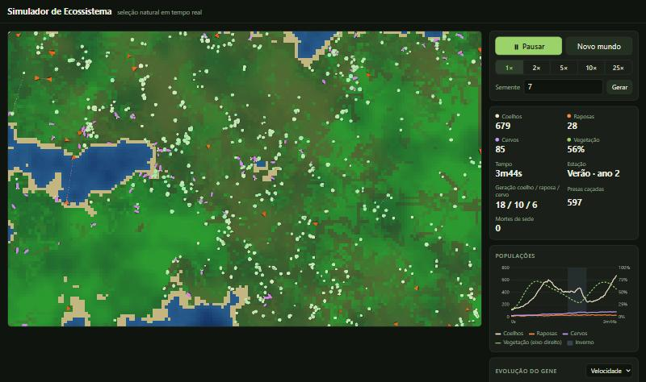

# 🌿 Simulador de Ecossistema

**Plantas, coelhos, cervos e raposas evoluindo por seleção natural, em tempo real, no navegador.**

Cada animal nasce macho ou fêmea, com genes de **velocidade**, **visão** e **tamanho** herdados do pai e da mãe, com pequenas mutações. Ninguém programou qual é o "melhor" animal: quem come, bebe, foge, encontra parceiro e se reproduz melhor deixa mais filhotes, e a população muda sozinha ao longo das gerações e das estações do ano.

▶️ **[Abrir o simulador](https://leonardoalexanderxubento.github.io/ecossistema-simulador/)**



## O que observar

- **Ciclos predador–presa.** Coelhos se multiplicam → raposas têm comida e se multiplicam → coelhos despencam → raposas passam fome → a vegetação volta → tudo recomeça. São as oscilações descritas pelas equações de [Lotka–Volterra](https://pt.wikipedia.org/wiki/Equa%C3%A7%C3%B5es_de_Lotka%E2%80%93Volterra), surgindo só a partir de regras individuais.
- **Corrida armamentista evolutiva.** Com raposas por perto, coelhos mais rápidos sobrevivem; com coelhos mais rápidos, só as raposas mais rápidas comem. No gráfico _Evolução do gene_, as duas curvas sobem juntas.
- **Genes que deixam de compensar.** Sem predadores, enxergar longe só gasta energia, e a visão média dos coelhos encolhe com as gerações.
- **O ritmo das estações.** Os coelhos se multiplicam na primavera e no verão e despencam no outono e no inverno, quando o capim quase para de crescer e o frio custa energia. No gráfico de populações, os invernos aparecem em azul.
- **Cada um no seu nicho.** Coelhos e cervos disputam o capim, mas só os cervos alcançam as folhas dos arbustos. Sem esse recurso exclusivo, uma espécie sempre acabava eliminando a outra (o [princípio da exclusão competitiva](https://pt.wikipedia.org/wiki/Princ%C3%ADpio_da_exclus%C3%A3o_competitiva)).
- **Emboscada na beira d'água.** Todos precisam beber, e as margens dos lagos viram pontos de encontro, e de caça.
- **Seleção sexual.** As fêmeas preferem machos grandes e bem alimentados. Em mundos sem muitos predadores, isso pode empurrar o tamanho médio para cima mesmo quando ser grande custa caro.

Dica: use a velocidade **10×** ou **25×**, escolha _Velocidade_ no gráfico de genes e deixe rodar alguns minutos.

## Como funciona

| Elemento | Regras |
| --- | --- |
| **Terreno** | Gerado com ruído de valor fractal: lagos, praias e campos. A umidade define a fertilidade do solo. |
| **Capim** | Cada célula tem uma biomassa (0–1) que cresce de forma logística e coloniza vizinhas. As raízes rebrotam depois de comidas. |
| **Arbustos** | Crescem devagar só em solo muito fértil (as manchas verde-escuras) e perdem as folhas no inverno. Só os cervos alcançam. |
| **Coelhos** | Procuram a célula com mais comida dentro da visão, roem o capim até a raiz e fogem quando avistam uma raposa. |
| **Cervos** | Grandes, lentos para se reproduzir e de vida longa. Comem folhas de arbusto e capim alto. Os adultos não temem raposas; os filhotes fogem. |
| **Raposas** | Quando têm fome, perseguem o coelho ou filhote de cervo mais próximo e dão um bote que pode falhar, seguido de um descanso. |
| **Energia** | Tudo custa energia: existir (∝ tamanho^0,75, mais no frio), enxergar (∝ visão) e se mover (∝ velocidade² × tamanho). Energia zerada é morte por fome. |
| **Água** | A reserva de água cai com o tempo, mais rápido no calor. Com sede, o animal vai até a margem mais próxima (pré-calculada com uma busca em largura) e bebe até se saciar. Água zerada é morte por sede. |
| **Estações** | Um ano dura 2 min 40 s em 1×. O crescimento das plantas, o frio e o calor seguem curvas suaves ao longo do ano. |
| **Reprodução** | Sexuada. A fêmea adulta e bem alimentada procura machos por perto e escolhe o maior e mais bem alimentado; o casal caminha um até o outro e nasce a ninhada. Cada filhote recebe cada gene da mãe ou do pai, com mutações. A mãe paga quase toda a energia. |
| **Migração** | Se uma espécie quase desaparece, ou sobra só um sexo, alguns migrantes chegam parecidos com a última população conhecida. Dá para desligar. |

### Compromissos evolutivos

Nenhum gene é bom de graça, e é isso que torna a evolução interessante:

- **Velocidade**: ajuda a achar comida, fugir e caçar, mas o gasto cresce com o quadrado da velocidade.
- **Visão**: avisa do perigo mais cedo e encontra comida mais longe, mas custa energia o tempo todo.
- **Tamanho**: guarda mais energia, acerta mais botes e é mais difícil de pegar, mas gasta mais para viver e para ter filhotes.

## Controles

- **Pausar/Continuar** (ou barra de espaço) e velocidades de **1× a 25×**
- **Novo mundo** ou **semente**: o mesmo número gera exatamente o mesmo mundo, e a semente fica na URL para compartilhar
- **Clique num animal** para inspecionar sexo, genes, energia, água, idade, geração, filhotes e o que ele está fazendo; o círculo tracejado mostra o alcance da visão, e uma linha rosa liga os casais
- **Parâmetros**: crescimento das plantas, chance e intensidade de mutação, estações do ano, sede, migração, e botões para soltar mais animais de cada espécie

## Rodando localmente

Requer [Node.js](https://nodejs.org/) 20 ou superior.

```bash
git clone https://github.com/Leonardoalexanderxubento/ecossistema-simulador.git
cd ecossistema-simulador
npm install
npm run dev
```

| Script | O que faz |
| --- | --- |
| `npm run dev` | Servidor de desenvolvimento com recarga automática |
| `npm run build` | Checagem de tipos e build de produção em `dist/` |
| `npm test` | Testes automatizados (Vitest) |
| `npm run sim -- 20000 42` | Roda 20.000 ticks sem interface com a semente 42 e imprime populações e genes médios; útil para ajustar o equilíbrio |

## Estrutura

```
src/
├── sim/            # Simulação pura, sem DOM (roda no navegador e no Node)
│   ├── random.ts   #   gerador pseudoaleatório com semente
│   ├── noise.ts    #   ruído de valor para o relevo
│   ├── terrain.ts  #   água, areia, grama, fertilidade e margens
│   ├── plants.ts   #   capim e arbustos
│   ├── climate.ts  #   estações do ano
│   ├── animal.ts   #   estado de cada animal
│   ├── genes.ts    #   herança, cruzamento, mutação e limites dos genes
│   ├── species.ts  #   parâmetros de cada espécie
│   ├── behavior.ts #   comportamento: pastar, beber, cortejar, fugir, caçar
│   ├── spatial.ts  #   índice espacial para buscar vizinhos rápido
│   └── world.ts    #   laço da simulação, acasalamento, mortes, migração
├── render/         # Desenho no canvas
├── ui/             # Painel, gráficos e histórico
├── config.ts       # Tamanho do mapa e populações iniciais
└── main.ts         # Liga tudo: laço com passo fixo, cliques, URL
tests/              # Testes de genética, clima e do mundo
scripts/headless.ts # Simulação sem interface
```

A simulação não depende do navegador, então pode ser testada e rodada no terminal. A aleatoriedade vem de um gerador com semente, o que torna cada execução reproduzível.

## Tecnologias

TypeScript (modo estrito) · Vite · Canvas 2D · Vitest · GitHub Actions + GitHub Pages. Nenhuma dependência em tempo de execução.

## Ideias para o futuro

- Lobos, um predador capaz de caçar cervos adultos
- Ferramenta de pincel para desenhar lagos e barreiras (e ver populações separadas evoluírem diferente)
- Exportar o histórico em CSV
- Árvore genealógica do animal selecionado
- Rodar a simulação num Web Worker

## Licença

[MIT](LICENSE)
